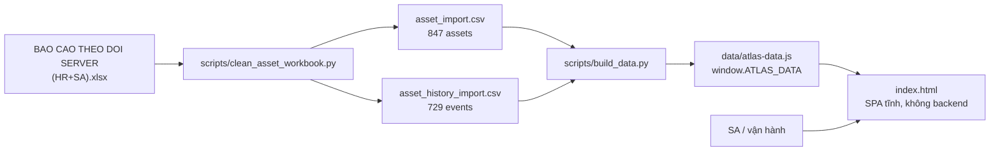
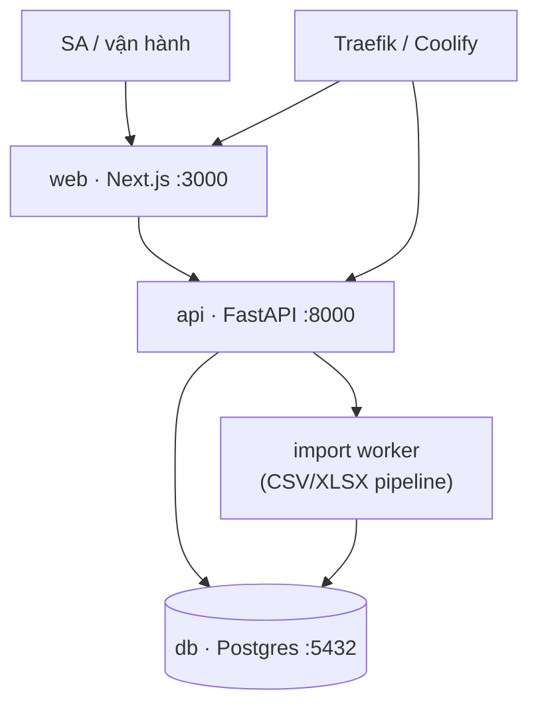
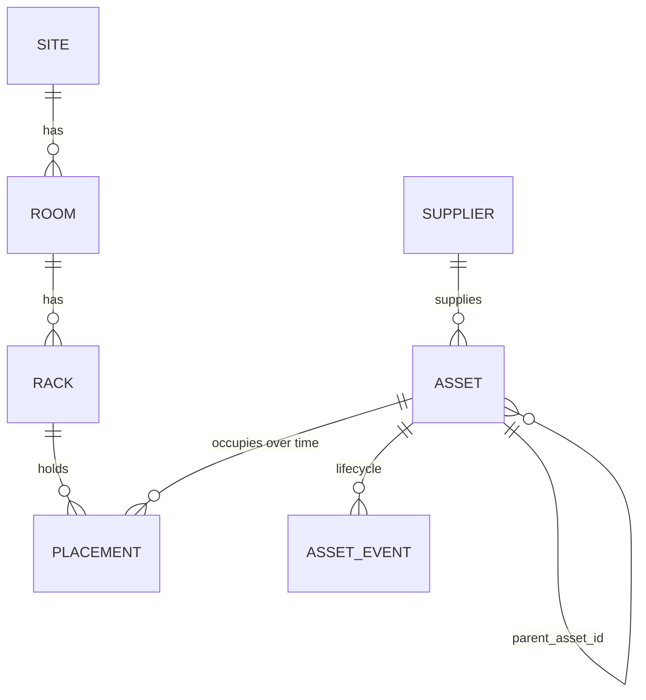

# ARCH — mgmt-device (Atlas Ops)

> Kiến trúc hệ thống quản lý tài sản hạ tầng của Mắt Bão.
> Cập nhật: 2026-09-09 · Owner: vydh (Đặng Hùng Vỹ) · Team: `sa`

## 1. Trạng thái hiện tại (iMVP / mockup)

Project đang ở dạng **prototype một file**, chưa có backend và chưa có lưu trữ.



| Thành phần | File | Trách nhiệm |
|---|---|---|
| Extract + clean | `scripts/clean_asset_workbook.py` | Đọc workbook Excel → chuẩn hóa trạng thái, loại thiết bị, ngày tháng → 2 file CSV. Cần `openpyxl`. |
| Bundle | `scripts/build_data.py` | Gói 2 CSV thành `data/atlas-data.js` (`window.ATLAS_DATA = { meta, assetRows, historyRows }`), giữ nguyên tên cột CSV. |
| UI | `index.html` | SPA tĩnh: 4 view (Tổng quan / Tài sản / Vị trí & Cụm / Nhập-Xuất) + drawer chi tiết. CSS + JS inline, không framework, không CDN. |
| Data contract | `mapAssetRow` / `mapHistoryRow` trong `index.html` | Map cột CSV → record hiển thị. Dùng chung cho data đóng gói **và** file user import → import lại `asset_import.csv` tái tạo đúng state ban đầu. |

**Giới hạn đã biết của bản hiện tại:**
- Không có persistence — mọi thao tác thêm/sửa/xóa mất khi tải lại trang.
- Xác thực: tài khoản nằm trong bảng `app_user`, mật khẩu băm scrypt, phiên lưu ở `user_session`.
  Chưa phân quyền theo vai trò (mọi tài khoản đang là `admin`).
- Nguồn dữ liệu chỉ ghi tới mức **site**; phòng máy, rack, vị trí U **chưa tồn tại**.
- 388/394 `parent_reference` là nhãn cụm (`VNPT1`, `ClusterX1`…), không phải mã tài sản.

## 2. Kiến trúc đích (chuẩn AI Factory)

Khi rời giai đoạn mockup, bắt buộc về đúng bộ công nghệ chuẩn — version linh hoạt nhưng phải scan CVE.



| Service | Port | Base image | Trách nhiệm |
|---|---|---|---|
| `web` | 3000 | `node:22-alpine` | Next.js — danh mục, sơ đồ rack, review queue |
| `api` | 8000 | `python:3.12-slim` | FastAPI — REST + validate import + business rules |
| `db` | 5432 | `postgres:17-alpine` | Nguồn sự thật duy nhất |

Orchestration: `docker-compose.yml` · Deploy: Coolify (`ops.matbao.ai`) · Domain: `mgmt-device.sa.dev.matbao.ai`.

> **Gate stack:** hiện KHÔNG dùng công nghệ ngoài chuẩn (không Django/Vue/Mongo) nên không cần
> `request_tech_exception`. Nếu sau này lệch khỏi Next.js/FastAPI/Postgres → phải xin duyệt qua MCP.

## 3. Data model đích

Điểm khác biệt lớn nhất so với sổ Excel: **tách vị trí thành cấu trúc phân cấp** thay vì một chuỗi text.



```sql
-- Location hierarchy (mới — sổ nguồn chưa có room/rack)
site        (id, code, name, kind, provider, address)          -- ODS, Kho, VNPT Tân Thuận, CMC Tân Thuận, CMC Quận 9
room        (id, site_id, code, name)
rack        (id, room_id, code, name, height_u)
placement   (id, asset_id, rack_id, start_u, size_u, from_date, to_date)  -- to_date NULL = đang đặt

-- Asset master
asset       (id, asset_id UNIQUE, name, asset_type, asset_category, status,
             cluster, ip_address, ip_or_type_raw, capacity, replacement_target,
             usage_start_date NULL, handover_date, purchase_invoice, purchase_price_vnd,
             supplier_id, warranty_months, warranty_end_date, description,
             parent_asset_id NULL, attachment_target_label NULL,   -- hai trường tách bạch
             current_site_id, current_room_id, current_rack_id,
             source_sheet, source_row, review_flags TEXT[])

asset_event (id, asset_id, event_sequence, event_type, event_date NULL,
             site_id NULL, location_label, usage_object, declared_transition_count,
             source_column, source_row, review_flags TEXT[])

supplier    (id, code, name)
```

**Ràng buộc nghiệp vụ bắt buộc giữ:**

| Quy tắc | Lý do |
|---|---|
| `usage_start_date` NULL hợp lệ, UI hiển thị `Null` mờ | 531/847 tài sản không có ngày trong sổ — cấm bịa ngày |
| `parent_asset_id` và `attachment_target_label` là **hai cột riêng** | 388 nhãn cụm chưa khớp mã; không được ép thành quan hệ cha-con giả |
| `status` giữ đủ 8 trạng thái nghiệp vụ | `in_use`, `in_use_needs_replacement`, `in_stock`, `not_in_use`, `degraded`, `broken`, `pending_disposal`, `retired` — không gộp thành active/inactive |
| `review_flags` không bao giờ bị nuốt | Dữ liệu thiếu phải hiện ra để người vận hành xử lý, không tự điền |
| Vị trí hiện tại tính từ event mới nhất đã duyệt | Tránh lệch giữa `current_location` và lịch sử |

## 4. Luồng import

```
XLSX/CSV → validate từng dòng → preview (số dòng, dòng lỗi) → upsert theo asset_id
        → dòng lỗi xuất ra error CSV → sự kiện thiếu dữ liệu vào review queue
```

Khóa: `asset_id` (master), `asset_id + event_sequence` (lịch sử). Bản hiện tại đã chạy đúng
luồng này ở phía client; bản đích chuyển validate + upsert về FastAPI.

## 5. Bảo mật

| Hạng mục | Hiện tại | Đích |
|---|---|---|
| Auth | ✅ tài khoản trong database, scrypt (N=16384, r=8, p=1), cookie phiên HttpOnly + SameSite=Lax, hết hạn 8h | SSO nội bộ / OIDC |
| Authz | ❌ chưa phân vai trò — mọi endpoint dữ liệu chỉ yêu cầu "đã đăng nhập" | SA: full; HR/kế toán: đọc + trường tài chính; manager: đọc |
| Endpoint | `/api/data`, `/api/import/*`, `/api/export/*` đều trả 401 khi chưa đăng nhập | thêm rate limit + khóa tài khoản sau N lần sai |
| Secrets | không có secret thật trong repo | biến môi trường, không hardcode identity (đọc `$CODER_USER_EMAIL`) |
| Audit log | ❌ | ghi mọi thay đổi vị trí / trạng thái kèm người thực hiện |

## 6. Chạy bằng Docker Compose (đã dựng)

```
docker compose up -d --build     # db + api + web
docker compose run --rm seed     # nạp 2 file CSV vào Postgres (idempotent)
```

| Service | Cổng | Vai trò |
|---|---|---|
| `db` | 5432 (nội bộ) | Postgres 17, schema tự chạy từ `db/schema.sql` |
| `api` | 8000 (nội bộ) | FastAPI: `/api/data`, `/api/import/*`, `/api/export/*.csv`, `/api/docs` |
| `web` | `${WEB_PORT:-8080}` | nginx phục vụ `index.html` + proxy `/api/` sang api |
| `seed` | — | chạy một lần, nạp CSV vào database |

Trang tự dò `/api/data`; có database thì đọc từ Postgres, không có thì rơi về `data/atlas-data.js`
nên vẫn mở trực tiếp bằng file:// được. Nhập/xuất CSV khi có database đi thẳng vào Postgres.

## 7. Việc chưa làm

1. Chưa có git repo trên `git.matbao.support`.
2. Chưa có CI, chưa có test tự động.
3. Bảng `room` / `rack` / `placement` đã có schema nhưng chưa có màn nhập liệu (iMVP Sprint 2).
4. Chưa phân quyền theo vai trò, chưa có rate limit / khóa tài khoản, chưa có màn đổi mật khẩu.
