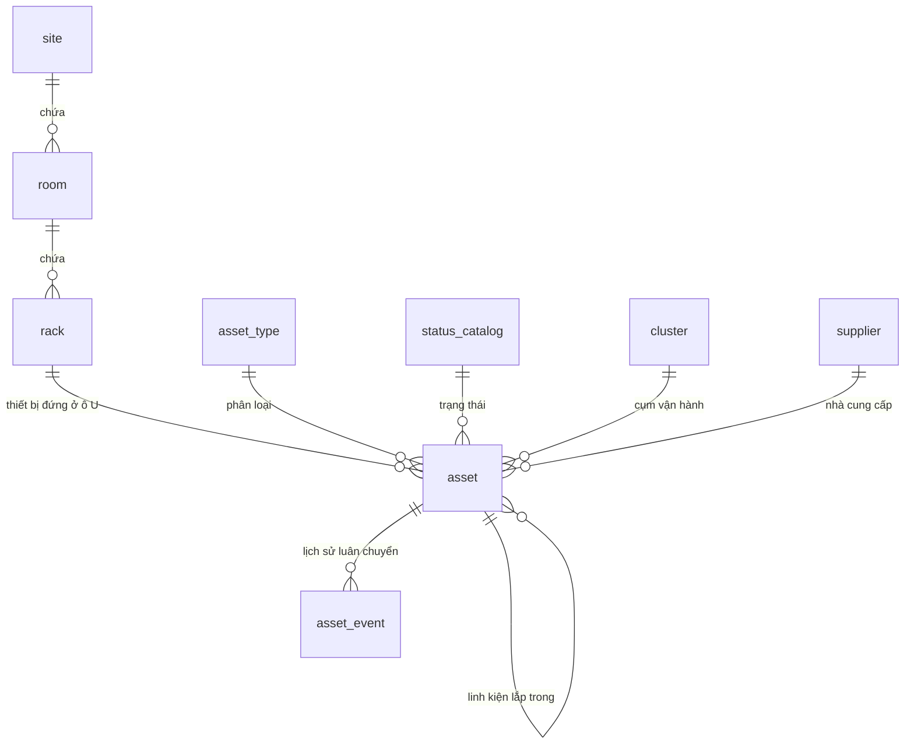
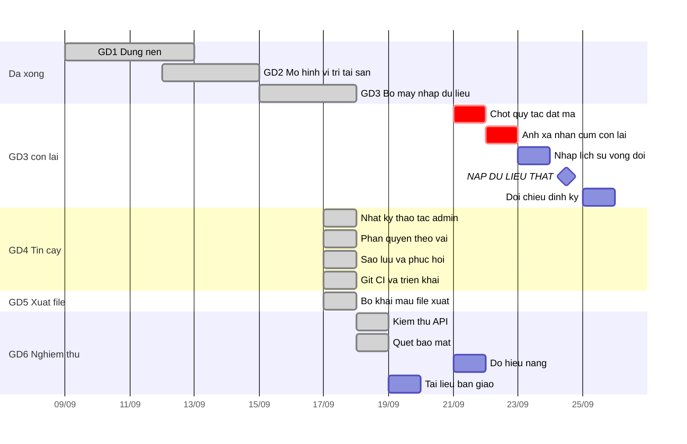

# PHẦN 1 — Ứng dụng này là gì

## 1.1 Vấn đề nó giải quyết

Hiện tại tài sản là thiết bị và linh kiện điện tử được team system admin trực tiếp quản lý và sử dụng.
Phòng hành chính và tài chính phối hợp theo dõi thông qua file Excel và đang được nâng cấp chuyển lên ERP với module quản lý tài sản đang phát triển.
Tuy nhiên vì đặc thù công việc của team system admin, việc quản lý thông qua các cách trên là không phù hợp.
Ứng dụng này được phát triển để đáp ứng nhu cầu đó, các tính năng chính của ứng dụng:
1. Trực quan (có filter, sơ đồ liên kết)
2. tin cậy (sử dụng database postgree, có lưu lịch sử thao tác của admin, có thể khôi phục khi lỗi, sai dữ liệu)
3. rõ ràng (mỗi thiết bị, linh kiện có lịch sử sử dụng từ khi nhập kho tới khi hết vòng đời và thanh lý)
4. đa năng (ngoài việc quản lý tài sản, còn hỗ trợ quản lý việc sử dụng, luân chuyển thiết bị)
Ứng dụng vẫn hỗ trợ export dữ liệu ra file excel đúng theo mẫu, và trường thông tin cần thiết cho bộ phận hành chính và tài chính sử dụng.

## 1.2 Ba nguyên tắc dữ liệu

| **Chính xác** |
| **Rõ ràng** |
| **Minh bạch** |

## 1.4 Sơ đồ mô hình dữ liệu

---

# PHẦN 3 — Kế hoạch dự án

Kế hoạch này ghi nhận **toàn bộ khối lượng công việc của dự án**, gồm cả phần đã hoàn thành,
để project trên AI Factory phản ánh đúng công sức đã bỏ ra khi báo cáo — không chỉ liệt kê
việc còn lại.

**6 giai đoạn · 40 task · 168 giờ-AI.** Đã xong 125h (29 task), còn lại 43h (11 task)
— trong đó 1 task bỏ qua và 2 task hoãn theo quyết định của owner, còn **8 task · 30h** phải làm.

> **Dữ liệu đang chạy trong hệ thống là DỮ LIỆU MẪU**, dùng để dựng và kiểm chứng ứng dụng.
> Vì vậy thứ đã hoàn thành ở GĐ 3 là **bộ máy nhập và xử lý dữ liệu**, còn việc nạp dữ liệu
> thật vẫn nằm phía trước (task 3.10).

Sáu giai đoạn bám theo bốn tính năng chính ở mục 1.1:

| GĐ | Mục tiêu | Phục vụ tính năng | Task | ET | Trạng thái |
|---|---|---|---|---|---|
| 1 | Dựng nền: dữ liệu, database, API, giao diện | Nền cho cả bốn | 6 | 32h | ✅ Xong |
| 2 | Mô hình vị trí và tài sản | ① Trực quan · ④ Đa năng | 8 | 34h | ✅ Xong |
| 3 | Nhập và xử lý dữ liệu | ③ Rõ ràng | 11 | 49h | 🔶 36h/49h |
| 4 | Tin cậy và vận hành an toàn | ② Tin cậy | 7 | 23h | ✅ Xong |
| 5 | Phục vụ hành chính và tài chính | ③ Rõ ràng · xuất Excel | 4 | 16h | ⬜ Chưa |
| 6 | Nghiệm thu và bàn giao | Chuẩn AI Factory | 4 | 14h | ⬜ Chưa |

> **Về đơn vị ET:** tính bằng **giờ-AI** theo chuẩn AI Factory (1 ngày code tay ≈ 2h AI).
> ET của phần đã xong là **ước lượng hồi cố** dựa trên khối lượng thực tế đã giao
> (9.089 dòng mã · 10 script · 21 bộ kiểm thử · 19 lần nhập dữ liệu), không phải bấm giờ.

---

## 3.1 Giai đoạn 1 · Dựng nền — 32h · ✅ Xong

| # | Task | Kết quả đã giao | ET |
|---|---|---|---|
| 1.1 | Bóc sổ Excel thành dữ liệu máy đọc được | `clean_asset_workbook.py` → 847 tài sản + 729 sự kiện, giữ `source_row` truy ngược | 6h |
| 1.2 | Thiết kế và dựng database | PostgreSQL, 13 bảng, ràng buộc khóa ngoại và `ON UPDATE CASCADE` | 4h |
| 1.3 | Xây API | FastAPI, 36 endpoint, whitelist cột sửa được | 9h |
| 1.4 | Xây giao diện | SPA một file 2.938 dòng, 8 màn hình, không framework | 8h |
| 1.5 | Đăng nhập và phiên làm việc | Mật khẩu băm scrypt, phiên lưu trong database | 2h |
| 1.6 | Đóng gói triển khai | Docker Compose 4 container + nginx | 3h |

## 3.2 Giai đoạn 2 · Mô hình vị trí và tài sản — 34h · ✅ Xong

| # | Task | Kết quả đã giao | ET |
|---|---|---|---|
| 2.1 | Ba cấp vị trí Site → Phòng máy → Rack | Danh mục CRUD, cấp con chọn cấp cha, xóa từ dưới lên | 5h |
| 2.2 | Vị trí U trong rack | Chuẩn EIA-310, chặn trùng ô, chặn U ngoài chiều cao rack | 4h |
| 2.3 | Linh kiện lồng trong thiết bị cha | Quan hệ tự tham chiếu, linh kiện không chiếm ô U | 4h |
| 2.4 | Luân chuyển kèm linh kiện | Dời cả cụm theo đệ quy, ghi lịch sử cho từng bản ghi | 5h |
| 2.5 | Kho tách riêng | Kho là cờ trên tài sản, không phải site; loại trừ với vị trí | 4h |
| 2.6 | Sơ đồ hạ tầng dạng cây | Dựng theo nhánh đang mở, sắp theo U từ trên xuống | 5h |
| 2.7 | Danh mục dùng chung | Loại tài sản, trạng thái, cụm — form chọn chứ không gõ tay | 3h |
| 2.8 | Nhập/xuất dữ liệu | CSV·XLSX hai chiều, xem trước từng bản ghi, template sinh tại chỗ | 4h |

## 3.3 Giai đoạn 3 · Nhập và xử lý dữ liệu — 49h · 🔶 36h đã xong, 13h còn lại

Giai đoạn này xây **năng lực** đưa dữ liệu vào hệ thống và xử lý cho đúng, chứ không phải
danh sách những lần nhập cụ thể. Nhập từ NetBox, từ sổ Excel hay từ bản xuất hệ thống ảo hóa
đều chỉ là **cách làm cho khớp thực tế đang có** — thực tế đổi thì cách nhập đổi theo, năng
lực bên dưới vẫn dùng lại được.

Toàn bộ phần đã xong được dựng và kiểm chứng trên **dữ liệu mẫu**. Nạp dữ liệu thật là task
3.10, chưa làm.

| # | Task | Tiêu chí xong | ET | Trạng thái |
|---|---|---|---|---|
| 3.1 | Đọc và làm sạch dữ liệu từ sổ Excel | Bóc được sổ chép tay thành dữ liệu máy đọc; tách lịch sử nhiều dòng trong một ô; lấy hiện trạng ở dòng cuối chứ không ở cột đã cũ | 8h | ✅ Xong |
| 3.2 | Nhận dữ liệu từ nguồn ngoài | Nhận được bản xuất của hệ thống khác (NetBox, hệ thống ảo hóa) và cả khối văn bản gõ tay, quy về cùng một bộ cột | 8h | ✅ Xong |
| 3.3 | Nối định danh giữa nguồn ngoài và hệ thống | Nối được IP quản trị / tên máy / vị trí rack sang mã tài sản, có đối chiếu chéo; **không nối được thì dừng và báo, không đoán** | 5h | ✅ Xong |
| 3.4 | Xem trước và kiểm soát trước khi ghi | Thấy rõ bản ghi nào thêm mới, bản ghi nào bị ghi đè và đổi trường gì; bỏ qua được từng bản ghi; có nhật ký nhập | 4h | ✅ Xong |
| 3.5 | Sinh dữ liệu theo quy tắc cấu hình | Khai quy tắc đấu nối rồi sinh ra bản ghi hàng loạt thay vì nhập tay | 3h | ✅ Xong |
| 3.6 | Kiểm trùng và xử lý xung đột khi nhập | Phân biệt được ba loại trùng: trùng mã, cùng vật khác mã, trùng thực chất — mỗi loại xử lý một kiểu | 3h | ✅ Xong |
| 3.7 | Chốt quy tắc đặt mã khi hai nguồn đánh mã độc lập | Quy tắc: **admin cấp mã, ứng dụng không tự thêm tiền tố**; đường nhập chặn đụng mã thay vì ghi đè | 2h | ✅ Xong |
| 3.8 | Tách cụm khỏi vị trí, có công cụ gán vị trí bằng tay | Cụm ↔ vị trí là **nhiều–nhiều** nên không ánh xạ tự động; lọc được theo cụm và theo "chưa gán cụm" rồi sửa hàng loạt để đặt rack | 3h | ✅ Xong |
| 3.9 | Nhập lịch sử vòng đời thiết bị | Tra được đường đi của một thiết bị từ nhập kho tới thanh lý | 4h | ⬜ Chưa |
| 3.10 | **Nạp dữ liệu thật thay dữ liệu mẫu** | Xóa sạch dữ liệu mẫu, nạp dữ liệu thật, đối chiếu lại số lượng và vị trí sau khi nạp | 6h | ⬜ Chưa |
| 3.11 | Đối chiếu định kỳ nguồn ngoài và hệ thống | Một lệnh ra bảng chênh lệch, so theo hiện trạng vật lý chứ không theo mã | 3h | ⬜ Chưa |

> Task 3.9 là điều kiện để đạt tính năng **③ rõ ràng** ở mục 1.1: bảng `asset_event` hiện
> đang rỗng nên chưa tra được lịch sử sử dụng của thiết bị.
>
> Task 3.10 là **mốc chuyển từ thử nghiệm sang vận hành thật** — mọi giai đoạn sau đều nên
> chạy trên dữ liệu thật, nên nó không được để trễ.

## 3.4 Giai đoạn 4 · Tin cậy và vận hành an toàn — 23h · ✅ Xong

Đây là giai đoạn hiện thực hóa tính năng **② tin cậy**: lưu lịch sử thao tác của admin và
khôi phục được khi lỗi hoặc sai dữ liệu.

| # | Task | Tiêu chí xong | ET |
|---|---|---|---|
| 4.1 | Nhật ký thao tác của admin ✅ | Mọi thay đổi truy được: ai sửa gì, lúc nào, giá trị cũ là gì — bảng `audit_log`, 24 endpoint ghi đều vào nhật ký | 5h |
| 4.2 | Phân quyền theo vai và mục Admin ✅ | Ba vai admin · sửa · chỉ xem, chặn ở tầng API; CRUD tài khoản; không hạ vai hay xoá được quản trị viên cuối cùng | 6h |
| 4.3 | Sao lưu database tự động ✅ | Cấu hình bật/tắt · lịch chạy · số bản giữ, kèm **nút sao lưu tay**, ngay trong mục Admin; **đã phục hồi thử thành công** (1232 tài sản khớp) | 3h |
| 4.4 | Tạo repo GitLab và đẩy README ✅ | [`gitlab.infra.matbao.io/matbao/mgmt-device`](https://gitlab.infra.matbao.io/matbao/mgmt-device) — README là nội dung tài liệu này; **chưa đẩy mã nguồn** | 2h |
| 4.5 | Rà soát bí mật trước khi đẩy ✅ | Không còn bí mật trong tập file commit; `.env` gitignore. ⚠ Mật khẩu database còn yếu — chưa đổi được | 1h |
| 4.6 | CI kiểm tự động mỗi lần đẩy ✅ | `.gitlab-ci.yml`: `npm test` trên fixture 30 tài sản + dựng ảnh Docker | 3h |
| 4.7 | Triển khai từ git thay cho chép tay ✅ | Mã nguồn đã lên GitLab; `scripts/trien_khai.sh` kéo git rồi dựng lại (owner cho bỏ qua nghiệm thu) | 3h |

## 3.5 Giai đoạn 5 · Xuất file theo mẫu bên nhận — 8h · ✅ Xong

| # | Task | Tiêu chí xong | ET |
|---|---|---|---|
| 5.1 | Bộ khai mẫu file xuất cho bộ phận khác | ✅ Màn **Phòng ban khác**: khai cột, tiêu đề 1–2 dòng, khuôn lấy dữ liệu, bảng đổi từ vựng, kiểu ô, phạm vi lọc và xem trước — tất cả trên giao diện. Gieo sẵn 3 mẫu | 8h |

> Bốn task cũ của giai đoạn này — xuất Excel đúng mẫu, cảnh báo bảo hành, báo cáo giá trị tài
> sản, tìm kiếm toàn cục — **bỏ hết** theo quyết định của owner. Giai đoạn rút về **đúng một
> việc**: cho phép tự khai mẫu file sẽ xuất ra, thay vì ghim cứng một mẫu vào code.
>
> Lý do đổi hướng: ghim cứng một mẫu thì mỗi bộ phận đổi cột là phải sửa code và triển khai
> lại. Khai mẫu được thì bộ phận nào cũng phục vụ được, kể cả mẫu chưa từng thấy.
>
> **Mẫu thật đã có** — `NB-HR-Kiem ke thiet bi SA-26082026.xlsx`, sheet *"Dữ liệu làm sạch sẽ
> up lên ERP"*: 19 cột có nội dung, **header hai dòng** (dòng 1 tiếng Việt cho người đọc, dòng 2
> là đường dẫn trường của ERP, ví dụ `Equipment/Product Information/Serial Number`), 862 dòng
> dữ liệu. Đây là **định dạng nạp vào ERP chứ không phải báo cáo để đọc** — sai một tên cột là
> ERP từ chối cả file, nên mẫu phải khai được đến từng dòng tiêu đề.

## 3.6 Giai đoạn 6 · Nghiệm thu và bàn giao — 14h · 🔶 8h đã xong, 6h còn lại

| # | Task | Tiêu chí xong | ET |
|---|---|---|---|
| 6.1 | Kiểm thử tầng API | ✅ 146 ca chạy bằng HTTP thật; tự đối chiếu bảng route nên **cả 36 endpoint ghi** đều có ca kiểm | 5h |
| 6.2 | Quét bảo mật | ✅ Bandit 0 HIGH · pip-audit 11 lỗ hổng → 0 · Trivy 6 lỗi có bản vá → 0 (còn 47 lỗi Debian chưa vá) | 3h |
| 6.3 | Đo hiệu năng trên dữ liệu thật | p95 dưới 500ms, đo sau khi đã nạp dữ liệu thật ở task 3.10 | 2h |
| 6.4 | Tài liệu vận hành và cập nhật ARCH | Người khác vận hành được mà không cần hỏi | 4h |

---

## 3.7 Tiến độ

Phần đã xong trải từ 09/09 đến 17/09/2026. Phần còn lại giả định **7 giờ làm việc mỗi ngày,
một người**, bắt đầu thứ Hai **21/09/2026** — còn **6h ≈ 1 ngày công** phải làm, chưa kể
1 task bỏ qua và 2 task hoãn chờ duyệt project.

Dạng bảng, nếu biểu đồ trên không hiển thị được:

| Giai đoạn | Task | ET | Mốc dự kiến | Ghi chú |
|---|---|---|---|---|
| GĐ 1 · Dựng nền | 6 | 32h | 09/09 → 11/09 | ✅ Đã xong |
| GĐ 2 · Mô hình vị trí | 8 | 34h | 12/09 → 14/09 | ✅ Đã xong |
| GĐ 3 · Nhập và xử lý dữ liệu (đã làm) | 8 | 36h | 15/09 → 17/09 | ✅ Bộ máy nhập, chạy trên dữ liệu mẫu |
| GĐ 3 · Nhập và xử lý dữ liệu (còn lại) | 3 | 13h | — | 1 bỏ qua · 2 hoãn chờ duyệt project |
| GĐ 4 · Tin cậy (đã làm) | 4 | 16h | 17/09 | ✅ Nhật ký · phân quyền · sao lưu · repo GitLab |
| GĐ 4 · Tin cậy (còn lại) | 3 | 7h | 17/09 | ✅ Rà bí mật · CI · triển khai từ git |
| GĐ 5 · Xuất file theo mẫu bên nhận | 1 | 8h | 17/09 | ✅ Xuất thử ra 1.234 dòng × 19 cột đúng hình dạng mẫu |
| GĐ 6 · Nghiệm thu (đã làm) | 2 | 8h | 18/09 | ✅ Kiểm thử API · quét bảo mật |
| GĐ 6 · Nghiệm thu (còn lại) | 2 | 6h | — | Hiệu năng chờ dữ liệu thật · tài liệu vận hành |

## 3.8 Tổng khối lượng

| | Task | Giờ-AI | Tỷ lệ |
|---|---|---|---|
| Đã hoàn thành | 32 | 141h | 88% |
| Còn lại (gồm 1 bỏ qua · 2 hoãn) | 5 | 19h | 12% |
| **Tổng dự án** | **37** | **160h** | |

Trong 5 task còn lại: **2 task phải làm (6h)** — đo hiệu năng và tài liệu vận hành; 1 bỏ qua và
2 hoãn theo quyết định của owner. Task 6.3 (hiệu năng) phụ thuộc 3.10 nên cũng đang chờ duyệt
project mới nạp được dữ liệu thật để đo.
Tổng giảm từ 40 task / 168h xuống 37 task / 160h vì GĐ 5 rút 4 task còn 1.

Lưu ý khi đọc con số 74% đã hoàn thành: đó là **74% khối lượng xây dựng**, chạy trên dữ liệu
mẫu. Hệ thống chỉ thật sự vào vận hành sau task 3.10.

---

# PHẦN 4 — Cần duyệt trước khi thực hiện

Bốn điểm. **Chưa có xác nhận thì không tạo project/task nào trên AI Factory, và không bắt
đầu task nào.**

1. **Phạm vi và thứ tự sáu giai đoạn**, và đặc biệt: có đồng ý đưa cả **24 task đã hoàn
   thành** vào project không. Đưa vào thì báo cáo phản ánh đúng 168h công sức thực tế; không
   đưa vào thì project chỉ còn 42h và phần đã làm không được ghi nhận ở đâu cả.

2. **Quy tắc đặt mã khi hai nguồn đánh mã độc lập** — task 3.7 chặn ở đây. Hiện có 54 ca đụng
   mã giữa sổ và hệ thống trên dữ liệu mẫu; cần một quy tắc dùng được cho mọi lần nhập sau:
   - **(a)** Dịch mã của sổ lên sau, giữ nguyên thứ đang chạy. Nhanh, không đụng dữ liệu hiện
     có, nhưng mã trong ứng dụng khác mã ghi trên nhãn/hoá đơn của sổ.
   - **(b)** Trả dải gốc cho sổ, đổi mã 54 ổ đang lắp trong máy. Đúng về nguồn gốc (sổ có
     trước, có hoá đơn) nhưng phải đổi mã 54 bản ghi đang vận hành.

3. **Ánh xạ nhãn cụm còn lại** — task 3.8: `Sangfor tạm`, `monitor`, `MBO`, `IPv6` ứng với
   tủ nào, hoặc xác nhận là không có thông tin để đánh dấu đúng như vậy thay vì đoán.

4. **Có tạo project trên AI Factory không.** Nếu đồng ý: tạo 1 project + 40 task theo đúng
   bảng trên, gắn 6 milestone theo sáu giai đoạn, 24 task đánh dấu `done` ngay từ đầu.
   Danh sách task sẵn ở [`docs/tasks.csv`](./tasks.csv) để tạo hàng loạt, không gõ tay.

---

## Phụ lục — quan hệ với tài liệu cũ

`docs/PLAN.md` ghi ngày 09/09/2026 và **đã lạc hậu**: phần lớn Sprint 0–3 trong đó hoặc đã
làm xong, hoặc đã đi hướng khác (ví dụ Sprint 1 đề xuất scaffold Next.js, thực tế vẫn là SPA
một file theo đúng `CLAUDE.md`). File này thay thế nó về mặt kế hoạch. **Chưa xoá/ghi đè
`PLAN.md`** — chờ duyệt xong mới thay, để còn đối chiếu.

`docs/ARCH.md` (14/09) vẫn mô tả đúng kiến trúc nhưng thiếu phần đã làm sau đó (kho, sơ đồ,
luân chuyển, bộ kiểm khói). Sẽ cập nhật trong task 6.4.
